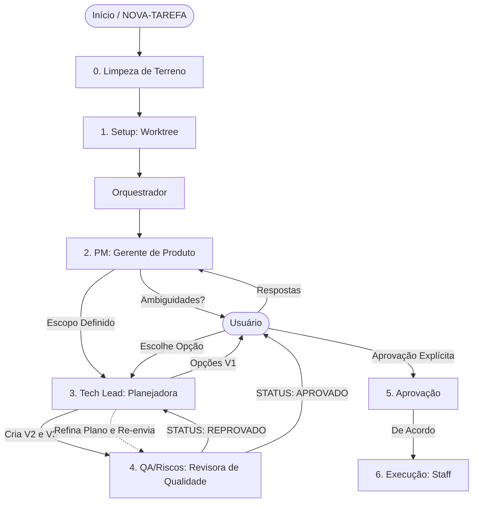

# Planejar Tarefa

## Instructions

Para orquestrar esta skill, você deve acionar a **Planejadora (Tech Lead)** logo no início e passar a requisição para ela. Ela possui autonomia para conduzir todo o fluxo e invocar as demais especialistas (Gerente de Produto e Revisora de Qualidade) conforme as fases abaixo. Você atuará apenas como o **Despachante e Orquestrador Inicial**.

**Antes de qualquer ação, consulte `code/PROJECT-REFERENCE.md` para conhecer hooks, componentes e padrões disponíveis — isso evita reimplementar o que já existe.**

Nota: se for fornecido um código de tarefa como argumento, busque os dados iniciais usando a tool `backlog` com a action `select` (ex: `backlog` com `action: "select"` e `query: "<código>"`) e trate a saída como o conteúdo de `NOVA-TAREFA.<nome-da-tarefa>.md` para iniciar o fluxo.

### 0. Limpeza de Terreno (Antes de qualquer planejamento)

Antes de planejar, elimine o estado herdado de fases anteriores para reduzir ruído de contexto e evitar invocar colegas obsoletos:

1. **Keep-list desta fase (MANTENHA):** `planejadora` (Tech Lead), `gerente-produto` (PM), `revisora-qualidade` (QA). **DISPENSE:** `staff`, `desenvolvedora`, `revisora-codigo`, `homologadora`.
2. **Procedimento de limpeza:**
   - Rode `teammates` com `action: "online"` e liste os colegas ativos.
   - Para cada colega online que **NÃO** esteja na keep-list, rode `teammates` com `action: "dismiss"` e `teammateId: "<id>"`.
   - Rode `task` com `action: "list"` e identifique tasks de outras fases (execução/finalização).
   - Para cada task de **outra fase** (status `completed` ou `pending` sem dono), rode `task` com `action: "remove"` e `id: "<id>"`.
3. **Regras de segurança:**
   - NUNCA remova tasks da fase corrente (escopo/plano/auditoria).
   - NUNCA use `force: true` em `task remove` sem aprovação explícita do usuário.
   - NUNCA dispense um colega que esteja executando a fase corrente.
4. **Verificação:** confirme com `teammates online` que só restaram colegas da keep-list e com `task list` que só restaram tasks de planejamento.

### 1. Setup de Ambiente (Após limpeza de terreno)

Antes de iniciar a definição de escopo, prepare o ambiente isolado de desenvolvimento:

1. **Identificar a Branch:** Obtenha o nome da branch da tarefa definido na `NOVA-TAREFA.*.md` ou sugerido pelo usuário.
2. **Garantir Diretório de Worktrees:** Verifique se o diretório `.worktrees/` existe na raiz do projeto. Se não, crie-o.
3. **Criar/Atualizar Branch:**
   - Certifique-se de que a branch de base (ex: `dev`) está atualizada.
   - Crie a branch da tarefa a partir da base, caso ela ainda não exista.
4. **Criar Worktree:**
   - Utilize `git worktree add .worktrees/<branch-name> <branch-name>`.
   - Se a branch for nova, use `git worktree add -b <branch-name> .worktrees/<branch-name> <base-branch>`.
5. **Validar Ambiente:** Verifique se os arquivos foram clonados corretamente para a worktree.
6. **Sinalizar Mudança de Contexto:** Informe ao usuário que a partir de agora, todas as edições, leituras e comandos de bash devem ser executados dentro do caminho `.worktrees/<branch-name>/`.

> O setup é executado automaticamente como fase inicial do plano, eliminando a necessidade de uma skill separada.

### 2. Definição de Escopo (Delegação: Agente Gerente de Produto)

A primeira etapa é isolar ambiguidades e extrair todas as regras de negócio de `NOVA-TAREFA.*.md` e do repositório de documentos `.context/project/product/`.

- A **`gerente-produto`** deve ser invocada pela Tech Lead via **teammates** para explorar os requisitos, cruzar com a base de conhecimento e gerar o "Relatório de Execução Segura".
- **Interação:** Se a Gerente de Produto encontrar ambiguidades, apresente as dúvidas geradas por ela ao usuário e **aguarde as respostas** antes de avançar.

### 3. Planejamento Arquitetural (Delegação: Agente Planejadora)

Com o escopo da Gerente de Produto alinhado, passe o trabalho de engenharia para a Planejadora.

- A **`planejadora`** tomará posse do Relatório da Gerente de Produto e das respostas do usuário para orquestrar as V1/V2.
- O objetivo da Planejadora é redigir o `.artifacts/<nome-da-tarefa>/PLANO.md` e suas opções arquiteturais.
- **Ação V1:** Instrua a Planejadora a apresentar no mínimo 2 opções de solução (V1 - Visão Geral).
- **Interação:** Exiba as propostas para o usuário e pergunte _"Qual opção técnica você deseja seguir?"_, depois **aguarde a decisão**.

### 4. V2, V3 e Loop de Revisão Adversarial (Delegação: Agente Revisora de Qualidade)

Com a opção escolhida pelo usuário:

- A **Planejadora** fechará o passo a passo (V2) e especificações/contratos (V3). Ao definir subtasks paralelizáveis, garanta que **nenhum arquivo do projeto apareça em duas subtasks** e registre o mapeamento arquivo → subtask no `PLANO.md`. A Staff usa esse mapa para decidir entre Fast-Track e Legião.
- ANTES de aprovar o passo a passo como definitivo para o desenvolvimento, a **`planejadora`** deve invocar a **`revisora-qualidade`** via **teammates** para uma **revisão adversarial** da V2/V3 gerada. Ela procurará por cenários "unhappy path", falhas de arquitetura e edge cases, e registrará o laudo em `.artifacts/<nome-da-tarefa>/AUDITORIA.md` com veredito explícito: **STATUS: APROVADO** ou **STATUS: REPROVADO**.
- **Loop obrigatório até aprovação (limitado a 3 rodadas):**
  1. A `planejadora` envia a versão atual do `PLANO.md` à `revisora-qualidade` para revisão adversarial.
  2. Se o veredito for **REPROVADO**, a `planejadora` DEVE corrigir/fortalecer **todas** as pontuações listadas no `AUDITORIA.md`, atualizar o `PLANO.md` e **re-enviar a nova versão à `revisora-qualidade` para uma nova rodada de revisão** (voltar ao passo 1).
  3. O ciclo se repete até que a `revisora-qualidade` emita **STATUS: APROVADO**, com o limite máximo de **3 rodadas**.
  4. Se a 3ª rodada ainda resultar em **REPROVADO**, a `planejadora` interrompe o loop e escala ao supervisor com: número de rodadas, quais pontuações resistiram a correção e sua recomendação (seguir com ressalvas registradas ou revisar o escopo). Nenhuma 4ª rodada sem autorização explícita do usuário.
- **Um plano só é considerado concluído quando a última versão auditada tiver veredito **APROVADO**.** A `planejadora` não pode declarar o plano pronto por conta própria.

### 5. Apresentação e Aprovação do Plano (Usuário)

Com o `PLANO.md` (V3) **aprovado pela Revisora de Qualidade** (veredito **STATUS: APROVADO** na última rodada do loop adversarial):

1. **Apresente o plano completo ao usuário** — exiba o sumário executivo do `PLANO.md`: objetivo, arquitetura escolhida, fases, contratos e riscos mitigados.
2. **Pare e aguarde aprovação explícita.** Pergunte: _"O plano está aprovado? Posso iniciar a implementação?"_
3. O plano só avança pra execução após o usuário responder **"sim"** ou **"de acordo"** explicitamente.
4. Se o usuário pedir ajustes, retorne para a Planejadora refinar e volte ao passo 1.

### 6. Transição para Execução

Após aprovação explícita do usuário:

- **Encerramento:** Conclua o processo de planejamento técnico (Plan).
- **Aviso:** Informe ao usuário que agora o comando `/execute` deve ser chamado para realizar a codificação real seguindo o plano aprovado.

## Human-in-the-Loop (Segurança)

Apesar da delegação ocorrer autonomamente entre os subagentes, o avanço entre as Fases Críticas EXIGE uma pausa sua (Main Agent). Você deve sempre **apresentar os resultados ao usuário (ex: ESCOPO.md ou PLANO.md) e obter o "De Acordo"** antes de permitir que o fluxo vá de ponta a ponta.

## Fluxo Visual (Loop de Agentes)

## Rules

- **Jamais atropele as agentes**: deixe que a Gerente de Produto levante as dúvidas, que a Planejadora faça as propostas e que a Revisora de Qualidade critique. Você é o orquestrador que chama esses especialistas e serve de interface com o usuário.
- **Não tome decisões sozinho**: toda tomada de decisão estrutural de produto, arquitetura ou resolução de Edge Cases apontados deve passar pelo escopo da equipe e ser aprovada pelo usuário.
- **Loop adversarial até o fim**: a revisão da Revisora de Qualidade não é um evento único. Toda vez que ela emitir **REPROVADO**, o plano volta para a Planejadora refinar e re-enviar para nova revisão. O plano só avança para o usuário com **STATUS: APROVADO** explícito na última rodada.

## Examples

**Input:**
`/plan JUBA-456`

**Output:**
**Orquestrando contexto de produto com a PM: Invocando agente `gerente-produto`...**

[Relatório da Gerente de Produto é exibido, levantando regras de negócio e perguntas X, Y]
_Por favor, pode responder a essas questões da PM para seguirmos com o escopo?_ (Aguarde usuário)

**Após respostas:**
**Escopo alinhado! Invocando Tech Lead `planejadora` para elaborar arquitetura...**
[Apresenta Opção A e Opção B sugeridas pela Planejadora]
_Qual opção de arquitetura você prefere adotar?_ (Aguarde usuário)

**Após usuário escolher:**
**Criando passo a passo (V2) com `planejadora` e requisitando revisão de Qualidade da `revisora-qualidade`...**
[Mostra apontamentos da Revisora de Qualidade aplicados ao plano aprimorado pela Planejadora]
_Plano consolidado com sucesso. Podemos invocar a `staff` para seguir com a codificação._
